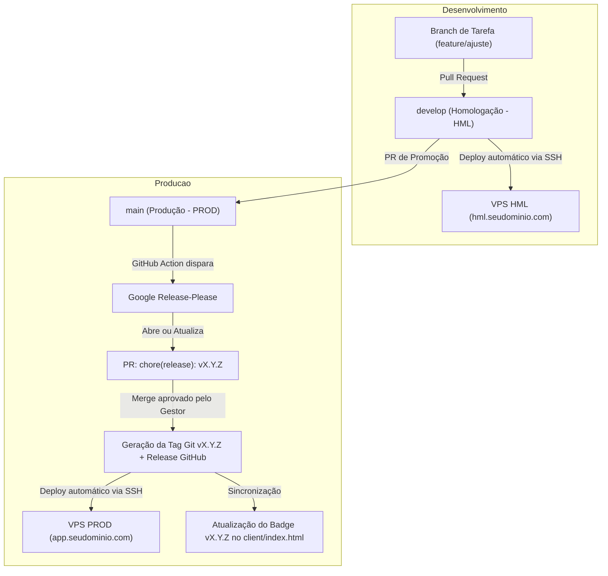

# 🏷️ Guia de Controle de Versionamento — CargaVE

Este documento define as diretrizes, padrões e fluxos automatizados de versionamento e release da aplicação **CargaVE**, adotando as melhores práticas da indústria com **Semantic Versioning (SemVer 2.0.0)**, **Conventional Commits** e automação via **Google Release-Please** no GitHub Actions.

---

## 📌 1. Visão Geral do Versionamento Semântico (SemVer)

O versionamento segue estritamente o formato:

$$\text{MAJOR} \,.\, \text{MINOR} \,.\, \text{PATCH} \quad (\text{Exemplo: } 1.0.0)$$

- **MAJOR (1.x.x $\to$ 2.0.0):** Alterações incompatíveis (*Breaking Changes*), como mudanças estruturais na API REST que quebrem clientes legados ou reestruturações completas de banco sem retrocompatibilidade.
- **MINOR (1.0.x $\to$ 1.1.0):** Novas funcionalidades compatíveis com a versão anterior (ex: novos cálculos, suporte a novos protocolos de carregadores, novos tipos de veículos).
- **PATCH (1.0.0 $\to$ 1.0.1):** Correções de bugs, pequenas melhorias de estabilidade, ajustes visuais ou de segurança sem adição de novos recursos.

---

## ✍️ 2. Padrão de Conventional Commits

Todas as alterações submetidas ao repositório devem seguir a convenção de mensagens em português (Brasil):

```text
<tipo>(<escopo opcional>): <descrição clara e sucinta>

[corpo opcional detalhando a motivação da mudança]
```

### Tabela de Tipos e Impacto no Versionamento

| Tipo | Descrição | Impacto no SemVer | Exemplo no CargaVE |
| :--- | :--- | :---: | :--- |
| **`feat`** | Nova funcionalidade ou recurso | **MINOR** (+0.1.0) | `feat(calc): adicionar simulador de perda de energia por temperatura` |
| **`fix`** | Correção de bug ou falha de cálculo | **PATCH** (+0.0.1) | `fix(ui): corrigir alinhamento do slider de bateria em telas menores` |
| **`perf`** | Melhoria de desempenho | **PATCH** (+0.0.1) | `perf(api): otimizar consulta ao catalogo de veiculos no PostgreSQL` |
| **`docs`** | Alteração em documentações | *Sem bump* | `docs(readme): atualizar instrucoes de inicializacao local` |
| **`refactor`**| Refatoração de código sem mudar comportamento | *Sem bump* | `refactor(server): modularizar rotas de sincronizacao de dados` |
| **`style`** | Ajustes de formatação/espaçamento de código | *Sem bump* | `style(css): ordenar variaveis de cores no tema escuro` |
| **`chore`** | Tarefas rotineiras, dependências ou scripts | *Sem bump* | `chore(deps): atualizar versao da lib helmet no package.json` |
| **`!` / `BREAKING CHANGE`** | Quebra de retrocompatibilidade | **MAJOR** (+1.0.0) | `feat(api)!: remover suporte a parametros legados de recarga` |

---

## 🔄 3. Fluxo de Branches e Ciclo de Vida de Releases



### Como funciona no dia a dia:
1. **Ambiente de Homologação:**
   - Todo desenvolvimento é integrado na branch `develop`.
   - O GitHub Actions faz o deploy contínuo imediato na stack `cargave-hml` da VPS.
2. **Preparação para Produção:**
   - Quando as funcionalidades estiverem validadas em HML, abra um Pull Request de `develop` para `main`.
   - Ao fazer o merge em `main`, o **Release-Please** roda silenciosamente.
3. **O Pull Request de Release:**
   - O Release-Please avalia todos os commits adicionados e abre um PR automático intitulado:
     `chore: release vX.Y.Z`
   - Esse PR já contém o arquivo `CHANGELOG.md` preenchido e as versões atualizadas em `package.json` e `server/package.json`.
4. **Publicação da Versão:**
   - Quando o gestor aprovar e mergear esse PR de release, a Tag Git oficial `vX.Y.Z` é criada automaticamente, a Release no GitHub é publicada e o deploy na stack de Produção (`cargave-prod`) é executado.

---

## 🎯 4. Fonte Única da Verdade da Versão

Para evitar discrepâncias entre telas e APIs, a versão do sistema segue uma arquitetura unificada:

1. **Definição Base:**
   - Centralizada no arquivo `package.json` na raiz e em `server/package.json`.
2. **Backend Dinâmico (`server/src/index.js`):**
   - O Express lê a versão dinamicamente via `require('../package.json')`.
   - Rota pública: `GET /api/versao` $\to$ `{"app": "CargaVE", "versao": "1.0.0"}`.
   - Rota de monitoramento: `GET /health` $\to$ status de saúde com versão incluída.
3. **Frontend SPA / PWA (`client/index.html` e `client/js/app.js`):**
   - No HTML: `<span class="app-badge" id="app-version">v1.0.0</span>`.
   - Na inicialização: o JavaScript consulta assincronamente `/api/versao` e atualiza a badge em tempo real.
   - Modo Offline: caso o usuário esteja sem conexão (PWA em cache), o valor estático do HTML garante a visualização imediata da versão daquele bundle.

---

## 🚀 5. Checklist para Renomeação do Repositório no GitHub

Para consolidar a identidade **CargaVE**:

1. Acesse o repositório no GitHub: **Settings** $\to$ **General** $\to$ **Repository name**.
2. Altere o nome de `kwhub-app` para `cargave-app` e confirme a alteração.
3. **Na sua máquina local (DEV):**
   ```bash
   git remote set-url origin git@github.com:cfgaspar10/cargave-app.git
   git remote -v
   ```
4. **Na VPS (HML e PROD):**
   ```bash
   cd ~/stacks/cargave-hml || cd ~/stacks/kwhub-hml
   git remote set-url origin git@github.com:cfgaspar10/cargave-app.git

   cd ~/stacks/cargave-prod || cd ~/stacks/kwhub-prod
   git remote set-url origin git@github.com:cfgaspar10/cargave-app.git
   ```
